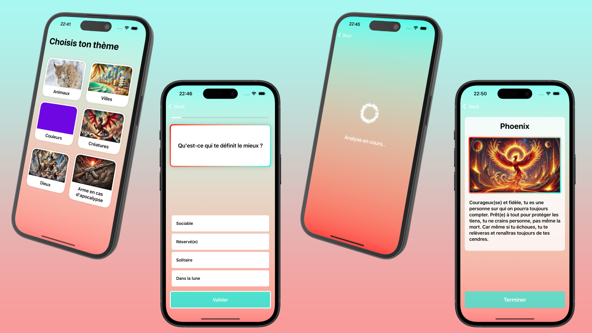

## Qui es tu ? / Application



## Qu'est ce que c'est ? 
Qui es tu ? est une application fun avec un concept simple. Choisis un thème, réponds à 10 questions et après une analyse ULTRA poussée faites par une centaines de scientifiques venant de la Silicon Valley, la meilleure correspondance te sera révélée !
Après avoir fait le thème révélant mon arme en cas d'apocalypse, je suis tombé sur le costume de huissiers de justice ! Plutôt pas mal non ? Et toi, quelle sera ton arme pour te défendre contre les zombies ?

## Support
* iOS 17.0

* Language: 
     - French
     - English (en cours)

## Installation
Télécharge l'app ici:
https://apps.apple.com/fr/app/qui-es-tu/id6740242586

Ou bien

1. Télécharge ce repo ou fork le.
2. Enregistre toi sur Firebase and télécharge ton propre GoogleService-info.plist.
3. Ajoute le au projet.
4. Enjoy !

## Vérification des images avant publication

Les images bitmap ont des entrées explicites 1x, 2x et 3x. Les trois entrées
réutilisent le fichier original ; les vues redimensionnent les images à l'affichage.
Pour vérifier les fichiers et les rendus présents dans une archive Release :

```sh
python3 scripts/verify-image-assets.py
python3 scripts/verify-image-assets.py "/chemin/Qui es tu.xcarchive/Products/Applications/Qui es tu.app/Assets.car"
```

Pour un catalogue réduit à un appareil, ajouter `--scale 2` ou `--scale 3`.
Exécuter aussi les tests `AssetPresenceTests` en Release avec
`ENABLE_TESTABILITY=YES` passé à `xcodebuild test` (pour les imports `@testable`).
Enfin, vérifier l'accueil et un résultat de quiz depuis le nouveau build TestFlight.

Pour les tests d’achats locaux, utiliser le simulateur iOS 27.1 : le runtime iOS
26.5 installé ici refuse les opérations `SKTestSession` lancées en ligne de
commande (`SKInternalErrorDomain Code=3`). Le schéma Run reste sans configuration
StoreKit locale pour les essais réels sur appareil. Les tests de prix vérifient
les chaînes localisées `displayPrice` utilisées par le paywall.

## Firebase Analytics et Crashlytics

### Correctif de sécurité Firestore — novembre 2026

Le minimum Swift Package Manager est Firebase **13.1.1** et la résolution des
dépendances est enregistrée dans `Package.resolved`. Cette version retire les
certificats racines concernés par la compromission eMudhra du magasin embarqué
de Firestore. Analytics utilise désormais le produit `FirebaseAnalyticsCore`,
qui conserve la configuration sans prise en charge de l’IDFA.

Après validation, archiver puis distribuer un nouveau build via TestFlight et
l’App Store, et inviter les utilisateurs à mettre l’app à jour. Les builds déjà
installés restent concernés : une modification du backend ou une mise à jour
d’iOS ne suffit pas. Ce dépôt couvre uniquement `qui-es-tu-d441b` ; SoleMate et
AnimalDex doivent être mis à jour dans leurs propres projets.

Sources : [consignes de remédiation Firebase](https://firebase.google.com/support/guides/compromised-emudhra-intermediate-ca),
[notes de version Apple SDK](https://firebase.google.com/support/release-notes/ios).

### Configuration

Le projet utilisé est `qui-es-tu-d441b`, application iOS `com.lucasamelin.Qui-es-tu`.
Analytics doit être activé dans les paramètres > Intégrations de la console Firebase.
Analytics (sans IDFA) et Crashlytics sont désactivés par défaut et peuvent être
activés séparément dans les réglages de confidentialité de l’app.
Les versions Debug, aperçus et tests automatiques n'envoient rien par défaut.

Événements métier : `quiz_started`, `quiz_completed`, `quiz_exited`, avec `quiz_id`
et un nombre de questions/réponses. Les réponses individuelles et les portraits
obtenus ne sont pas transmis. Les sessions et premières ouvertures sont gérées
par le SDK Analytics. Les échecs de chargement du catalogue sont enregistrés
comme erreurs non fatales, sans le contenu des documents ni les messages du serveur.

Pour vérifier Analytics : ajouter `-FIRDebugEnabled` aux arguments de lancement
du schéma Xcode, puis consulter Analytics > DebugView. Retirer cet argument et
lancer une fois avec `-FIRDebugDisabled` après la vérification (le mode Firebase
debug persiste sinon). Les événements DebugView sont exclus des rapports habituels.

Pour vérifier Crashlytics : lancer une version Debug sans débogueur avec
`-CrashlyticsDebugEnabled -CrashlyticsTestCrash`. Un crash volontaire survient
après trois secondes. Relancer avec seulement `-CrashlyticsDebugEnabled` pour
envoyer le rapport. Le déclencheur de crash n'existe pas dans une version Release.

La dernière phase de compilation envoie automatiquement les dSYM des builds
Release pour appareil. Les builds simulateur et Debug sont ignorés. Pour envoyer
ceux d'un build Debug sur appareil, définir `CRASHLYTICS_UPLOAD_DEBUG_SYMBOLS=YES`.
Si le cache Swift Package Manager est déplacé, adapter le chemin `Crashlytics/run`
dans cette phase. Pour un test sur simulateur, envoyer les dSYM manuellement avec
`Crashlytics/upload-symbols -gsp <GoogleService-Info.plist> -p ios <app.dSYM>`.

Une nouvelle version doit être distribuée pour instrumenter les installations
existantes ; les anciennes sessions ne sont pas récupérées rétroactivement.
Avant publication, mettre à jour les déclarations de confidentialité App Store
et la politique de confidentialité selon les données désormais collectées.

Documentation : [Analytics](https://firebase.google.com/docs/analytics/ios/get-started),
[DebugView](https://firebase.google.com/docs/analytics/debugview),
[Crashlytics](https://firebase.google.com/docs/crashlytics/ios/get-started).

## Me contacter
- Email: overtechapps@gmail.com
- Linkedin: <a href="https://www.linkedin.com/in/lucas-amelin-3b8b85190/">Linkedin</a>

## License
[MIT](https://choosealicense.com/licenses/mit/)

## Quiz hebdomadaires, Premium et publicités

L’app intègre les achats StoreKit (quiz à l’unité et Premium mensuel), les bannières
AdMob avec consentement, le partage de portraits, l’historique local et les alertes
de nouveaux quiz. La configuration actuelle active les achats côté app ; les annonces
de production restent désactivées. La disponibilité réelle dépend des produits Apple et des
vérifications de lancement documentées ci-dessous.

En Debug, toucher **Quiz payant de démonstration** sur l’accueil pour afficher
le paywall avec des prix fictifs (0,99 € le quiz, 1,99 €/mois Premium). Les boutons
simulent une confirmation sans paiement ni déblocage. Les lancements Debug normaux
affichent maintenant une bannière de test Google en bas de l’accueil et sur les
résultats, après le traitement du consentement. Les aperçus/tests UI hors réseau
conservent une bannière fictive. Les versions Debug ne demandent jamais une annonce
de production. Le quiz fictif et les contrôles de test sont absents des builds Release.

Le message de consentement européen AdMob est publié et son parcours a été vérifié
sur simulateur. Les annonces de production restent désactivées en attendant les
étapes App Store/app-ads.txt et les déclarations de confidentialité détaillées dans
le guide de lancement. Pour revérifier le premier lancement européen en Debug :
`-adTesting -adConsentEEA -adConsentReset` (retirer le dernier argument pour vérifier
la conservation du choix).

Sur appareil physique, le bloc **Publicité de test · DEBUG** en bas de l’accueil
indique aussi pourquoi une bannière est masquée (Premium, achats en attente,
consentement ou erreur réseau). **Réessayer la bannière** relance la demande sans
effacer le choix de consentement. Ce bloc est absent des versions Release.
Si Google indique une bannière chargée mais affiche seulement un rectangle noir
« Test mode », vérifier aussi le VPN ou le blocage publicitaire du réseau : sur
Sakana, leur suspension suivie d’un nouvel essai a fait apparaître la bannière complète.

Voir [le guide de lancement](docs/monetization-launch.md) pour la configuration,
les vérifications et les mesures du pilote. Les quatre premiers brouillons restent
locaux dans `content/pilot/`, exclu de Git, en attente de relecture et d’approbation.
Les tests du backend utilisent un exemple fictif et ne nécessitent pas ces fichiers.
Le backend Firebase se trouve dans `backend/` ; son état de déploiement et les
vérifications restant à effectuer sont consignés dans le guide de lancement.
